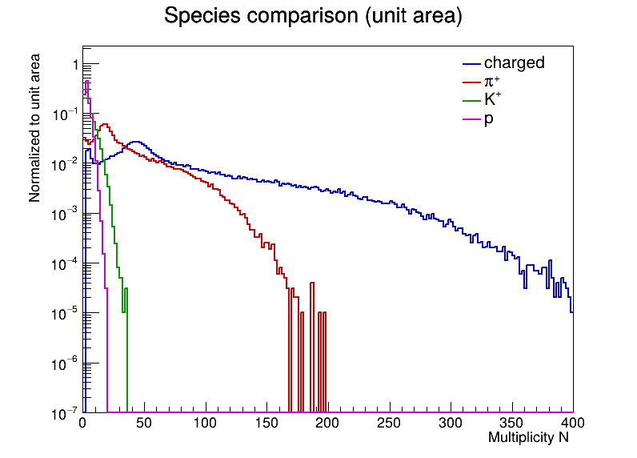
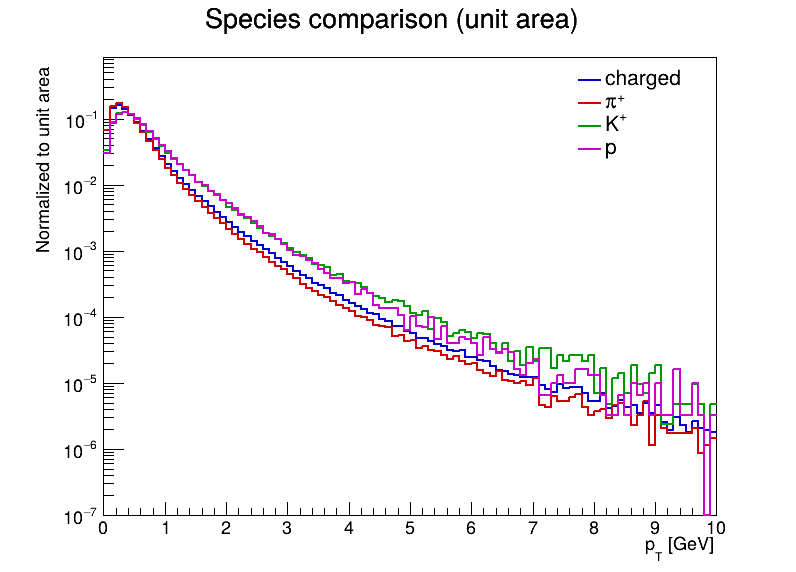
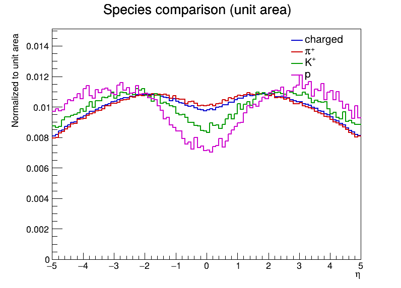
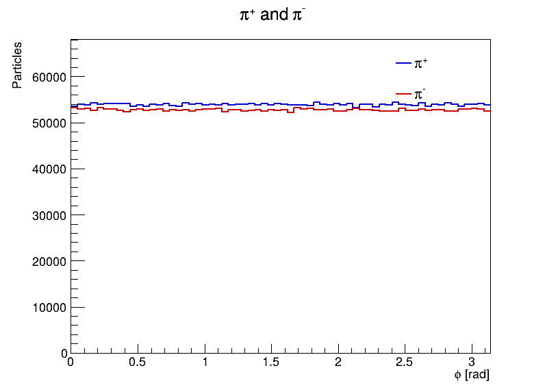
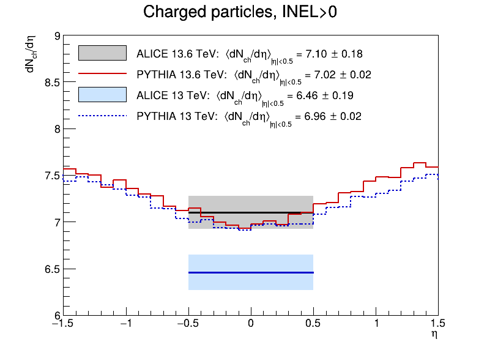
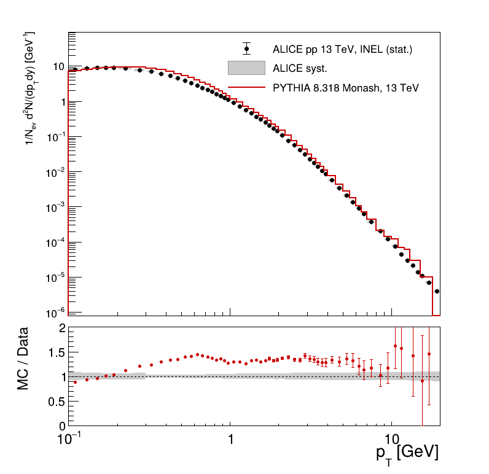
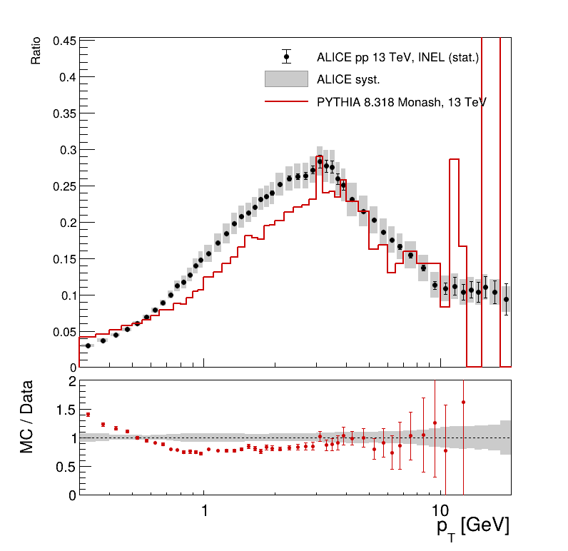

# pp @ √s = 13.6 TeV: symulacja w Pythii 8 i analiza w ROOT

Kompletny pipeline od generacji zderzeń proton–proton przy √s = 13.6 TeV (tryb minimum bias,
Pythia 8) do histogramów rozkładów cząstek końcowych w ROOT i wykresów w PNG/PDF.

Analizowane wielkości: krotność na zdarzenie (N), pęd poprzeczny (pT), pseudorapidity (η)
i kąt azymutalny (φ) dla kategorii: wszystkie cząstki naładowane, π⁺, π⁻, K⁺, K⁻, p, p̄
(oraz pomocniczo: wszystkie cząstki końcowe, zob. [Interpretacja zadania](#interpretacja-zadania-i-decyzje-implementacyjne)).

## Wyniki

100 000 zdarzeń pp przy √s = 13.6 TeV (`SoftQCD:inelastic`, Monash 2013, seed 12345).
Średnie obejmują wszystkie cząstki, także te poza zakresami histogramów.

| Kategoria | ⟨N⟩ na zdarzenie | ⟨pT⟩ [GeV] |
|---|---|---|
| naładowane (`ch`) | 83.92 | 0.527 |
| π⁺ / π⁻ | 34.51 / 33.77 | 0.492 / 0.494 |
| K⁺ / K⁻ | 4.25 / 4.12 | 0.679 / 0.676 |
| p / p̄ | 3.06 / 1.94 | 0.685 / 0.789 |
| wszystkie końcowe (`all`) | 181.65 | 0.416 |

- Skład cząstek naładowanych: π± 81.4%, K± 10.0%, p/p̄ 6.0%, reszta (e±, μ±, Σ±, Ξ⁻, Ω⁻) 2.7%.
- `all` ≈ 2 × `ch`: na zdarzenie przypada średnio 83.2 fotonów (głównie z rozpadów π⁰)
  i 14.5 innych cząstek neutralnych.
- Ułamek zdarzeń INEL>0 (co najmniej jedna cząstka naładowana w |η| < 1): 86.27%.
- **Nadmiar protonów nad antyprotonami** (3.06 vs 1.94): stan początkowy ma liczbę barionową +2,
  a ponad połowa protonów leci pod |η| > 5 (pozostałości wiązek).
- **Krotność cząstek naładowanych jest zawsze parzysta**: ładunek początkowy wynosi +2,
  więc N⁺ − N⁻ = 2 (żadne ze 100 000 zdarzeń nie ma nieparzystego N_ch).

| | |
|---|---|
|  |  |
|  |  |

Wszystkie wykresy są w [`plots/`](plots/).

## Wymagania i przetestowane wersje

| Składnik | Wersja |
|---|---|
| system | macOS 26.6 (arm64) |
| kompilator | Apple clang 21.0.0 |
| CMake | 4.3.1 (wymagane ≥ 3.20) |
| ROOT | 6.40.04 |
| Pythia | 8.318 |

Instalacja na macOS (Homebrew):

```bash
brew install cmake pythia root
```

Kod jest napisany w C++17 (kompiluje się też z `-std=c++17`). Budujemy go z `-std=c++20`, bo tego
wymagają nagłówki ROOT 6.40 z Homebrew.

## Budowanie

```bash
cmake -S . -B build
cmake --build build
```

Pythia jest wyszukiwana przez `pythia8-config`. Przy niestandardowej instalacji podaj prefiks:
`cmake -S . -B build -DPYTHIA8_DIR=/ścieżka/do/pythia8`.

## Uruchomienie

Pełny pipeline (generacja 100 000 zdarzeń → analiza → wykresy) jednym poleceniem:

```bash
cmake --build build --target pipeline
```

### 1. Generacja zdarzeń

```bash
mkdir -p output
./build/pp_generate --config config/pythia_13p6TeV.cmnd --nevents 100000 --seed 12345 \
                    --output output/events.root
```

**Opcje:**
- `--config <plik>`: ustawienia Pythii (domyślnie `config/pythia_13p6TeV.cmnd`)
- `--nevents <N>`: liczba zdarzeń (domyślnie 1000)
- `--seed <N>`: seed generatora (domyślnie 12345)
- `--output <plik>`: plik wyjściowy z TTree (domyślnie `output/events.root`)

**Proces:** `SoftQCD:inelastic`, tune Monash 2013.

### 2. Analiza

```bash
./build/pp_analyze --input output/events.root --output output/analysis.root
```

**Opcje:** `--input <plik>`, `--output <plik>` (domyślnie jak wyżej)

**Wyjście:** `output/analysis.root`
- 32 histogramy (4 zmienne × 8 kategorii): `hN_*`, `hPt_*`, `hEta_*`, `hPhi_*`
- **Zmienne:** N (0–400, 400 binów), pT (0–10 GeV, 100 binów), η (−5 do 5, 100 binów), φ (0–π, 64 biny)
- **Kategorie:** `all`, `ch`, `pip`, `pim`, `Kp`, `Km`, `p`, `pbar`
- Dodatkowo: `hPhiFull_*` (φ w (−π, π]), `hNevents` (liczba zdarzeń INEL i INEL>0), katalog
  `comparison/` (porównanie z ALICE)

### 3. Wykresy

```bash
root -l -b -q macros/draw_plots.C
```

**Wyjście:** `plots/`: 32 wykresy histogramów i 16 nakładek (π⁺/π⁻, K⁺/K⁻, p/p̄, porównanie
rodzajów cząstek), każdy w PNG i PDF.

## Struktura projektu

```
pp-13p6tev-analysis/
├── CMakeLists.txt
├── config/
│   ├── pythia_13p6TeV.cmnd
│   └── pythia_13TeV.cmnd
├── include/ppanalysis/
│   ├── Event.hpp
│   ├── Categories.hpp
│   └── Analyzer.hpp
├── src/
│   ├── generate.cpp            # pp_generate
│   ├── analyze.cpp             # pp_analyze
│   ├── Event.cpp
│   ├── Categories.cpp
│   └── Analyzer.cpp
├── macros/
│   ├── draw_plots.C
│   └── draw_comparison.C
├── reference/ins1797443/       # tabele HEPData
├── output/
│   ├── analysis.root
│   └── analysis_13TeV.root
├── plots/
└── presentations/
```

## Odtwarzalność

- Wszystkie ustawienia fizyczne są w `config/pythia_13p6TeV.cmnd`. Seed podawany jest
  w linii poleceń (domyślnie 12345).
- `pp_generate` wypisuje do logu wszystkie zmienione ustawienia Pythii.
- Ten sam plik konfiguracyjny, seed i wersje oprogramowania dają identyczne zdarzenia.

## Interpretacja zadania i decyzje implementacyjne

- `SoftQCD:inelastic` zamiast `SoftQCD:all`: bez zderzeń elastycznych, których nie ma
  w eksperymentalnych próbkach minimum bias.
- Cząstki końcowe = cząstki pierwotne w sensie ALICE (`ParticleDecays:tau0Max = 10` mm),
  analizowane są tylko cząstki z `isFinal()`.
- Analiza opiera się na kategoriach z punktu 2 zadania. `all` oznacza wszystkie cząstki końcowe,
  także neutralne (kategoria pomocnicza).
- Bez cięć kinematycznych (w pT i η): wartości spoza zakresów trafiają do binów przepełnienia i są wliczane do
  średnich (N > 400 w 11% zdarzeń dla `all`, |η| > 5 dla 27% cząstek naładowanych).
- `hPhi_*` zawiera |φ|, bo zadanie wymaga zakresu 0–π. Pełny zakres jest w `hPhiFull_*`.
- Wykres `hN_ch` ma biny scalone po 2, bo N_ch jest zawsze parzyste.

## Porównanie z danymi ALICE

Rozszerzenie wykraczające poza zadanie. Porównujemy poziom generatora z wynikami ALICE, które są
już skorygowane na efekty detektora do poziomu cząstek pierwotnych. Definicja cząstek pierwotnych
w MC (`tau0Max = 10` mm) odpowiada definicji ALICE. Źródła danych i ich pochodzenie opisuje
[`reference/README.md`](reference/README.md), a slajdy są w
[`presentations/alice_comparison.pdf`](presentations/alice_comparison.pdf).

```bash
cmake --build build --target run_13TeV     # 100 000 zdarzeń przy 13 TeV → output/analysis_13TeV.root
cmake --build build --target comparison    # macros/draw_comparison.C → plots/comparison/
```

### ⟨dN_ch/dη⟩ w |η| < 0.5, zdarzenia INEL>0

| √s | PYTHIA 8.318 Monash | ALICE | MC / ALICE |
|---|---|---|---|
| 13.6 TeV | 7.02 ± 0.02 | 7.10 ± 0.18 ([arXiv:2602.10658](https://arxiv.org/abs/2602.10658)) | 0.99 (−0.4σ) |
| 13 TeV | 6.96 ± 0.02 | 6.46 ± 0.19 ([arXiv:1509.08734](https://arxiv.org/abs/1509.08734)) | 1.08 |

Przy 13.6 TeV model zgadza się z pomiarem w granicach niepewności. ALICE podaje dla PYTHIA 8.311
Monash wartość 7.11. Przy 13 TeV ten sam model zawyża wynik o 8%, zgodnie z oceną ALICE w pracy
z 2016 r. (ok. 7% dla INEL>0 i 12% dla INEL).



### Widma pT pionów, kaonów i protonów przy 13 TeV

Dane ALICE: [HEPData ins1797443](https://www.hepdata.net/record/ins1797443)
(Eur. Phys. J. C 81 (2021) 256). Symulację liczymy tak samo jak ALICE: cząstki z centralnej części
(|y| < 0.5), te same przedziały pT, wynik na jedno zderzenie, przy czym liczymy wszystkie zderzenia
niesprężyste (INEL), a nie tylko INEL>0. Dolny panel to MC/Data: 1 oznacza zgodność, szare pasmo
to niepewność pomiaru.

| | |
|---|---|
|  |  |

Symulacja daje ok. 20% więcej pionów, kaonów i protonów niż ALICE. Częściowo wynika to z tego, że
przy 13 TeV model ogólnie zawyża liczbę cząstek naładowanych na zderzenie (o ok. 13%). Kaony
i protony powyżej 1 GeV zgadzają się z danymi w granicach ok. 10%, ale pionów jest za dużo
w całym zakresie pT. Przez to model daje o ok. 20% za mało kaonów i protonów w stosunku do pionów,
co widać na wykresach K/π i p/π. Cięższe cząstki mają też w danych wyższy średni pT niż
w symulacji, np. protony 0.97 GeV w ALICE i 0.86 GeV w MC.

### Ograniczenia

- Użyliśmy jednego ustawienia modelu (tune Monash 2013).
- Przy 100 000 zdarzeń symulacja ma mało cząstek powyżej ok. 5 GeV.
- Widma porównujemy przy 13 TeV, bo dla 13.6 TeV ALICE jeszcze ich nie opublikowało.
- Niepewności systematyczne ALICE są ze sobą powiązane między przedziałami pT, więc panel MC/Data
  to ocena jakościowa.

## Rozwiązywanie potencjalnych problemów

**Pythia nie znajduje plików XML**
```bash
export PYTHIA8DATA=$(pythia8-config --xmldoc)
```

**CMake nie znajduje Pythii**
```bash
cmake -S . -B build -DPYTHIA8_DIR=/ścieżka/do/pythia8
```

**ROOT przerywa działanie przy pierwszym histogramie** (`module map file not found`, brak
`MacOSX<wersja>.sdk`): Command Line Tools są starsze niż system.
```bash
softwareupdate --list
sudo softwareupdate -i "<Command Line Tools ...>"
```

**`pp_generate` nie może utworzyć pliku wyjściowego**
```bash
mkdir -p output
```

## Licencja

[MIT](LICENSE)
