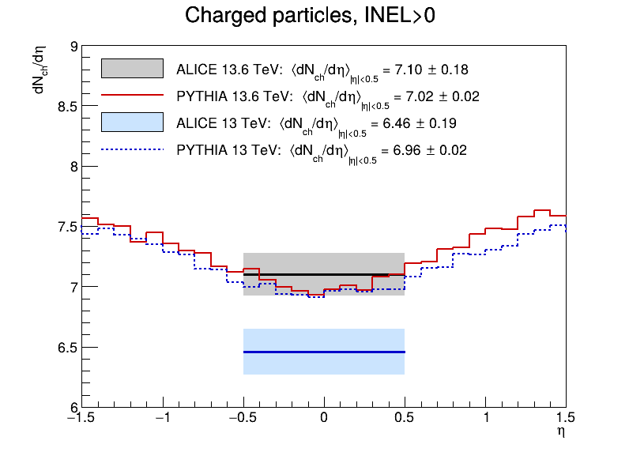
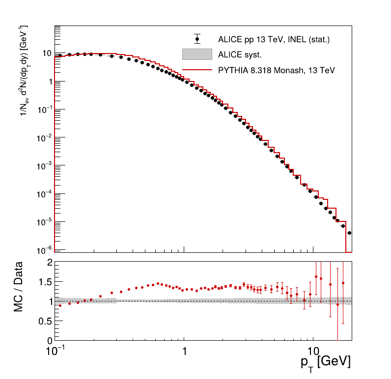
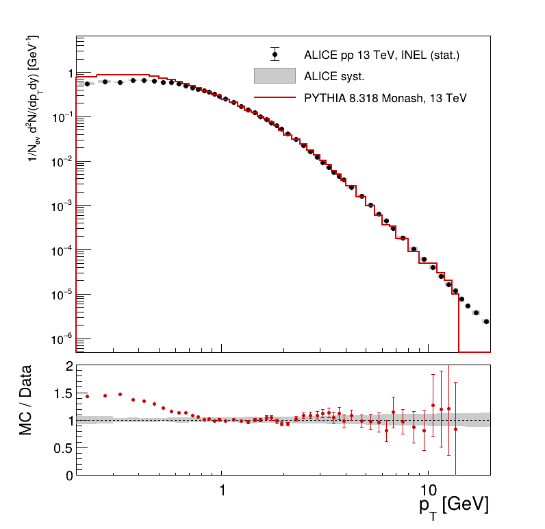
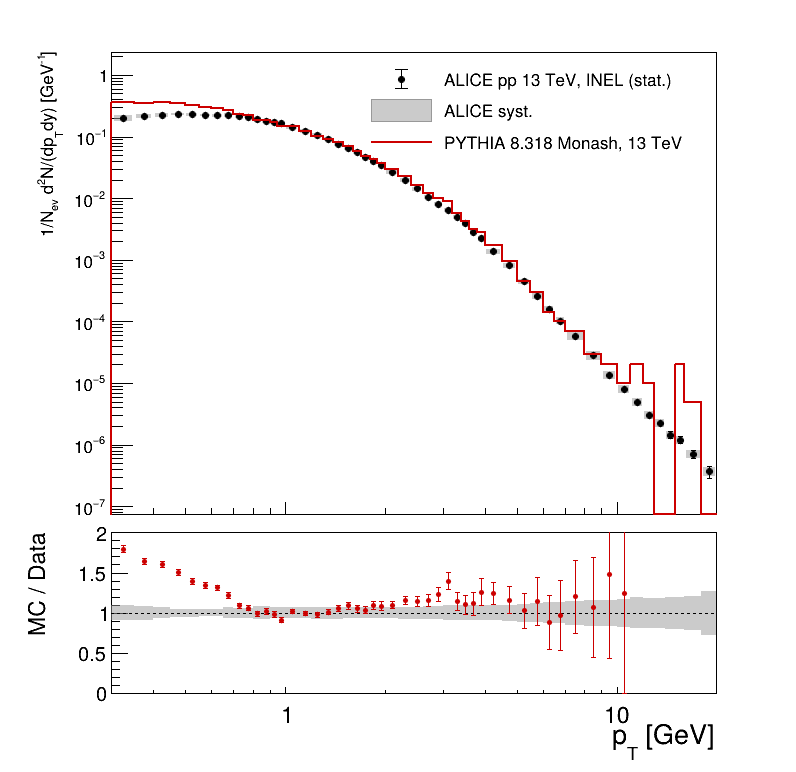
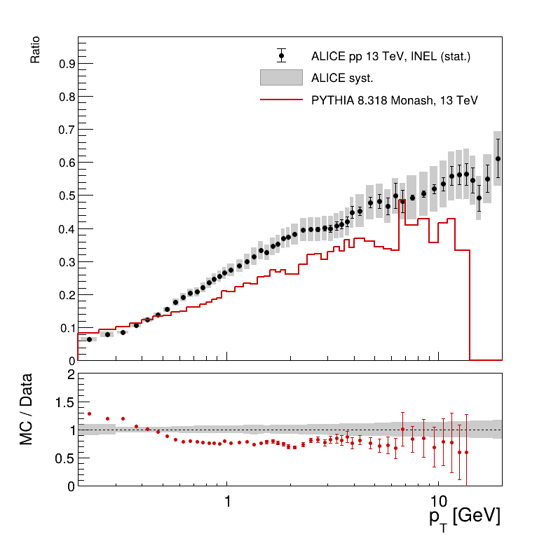
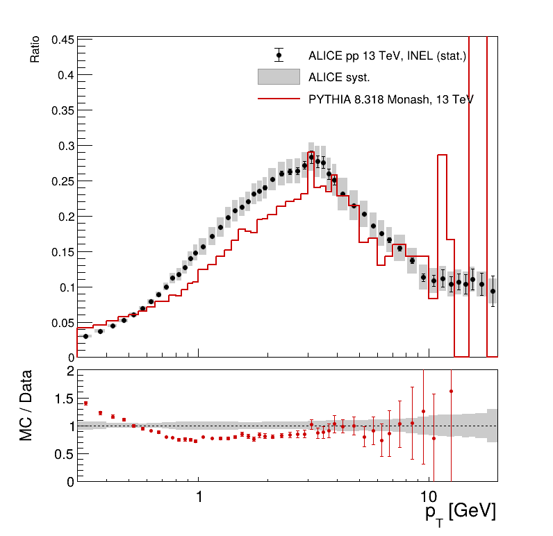
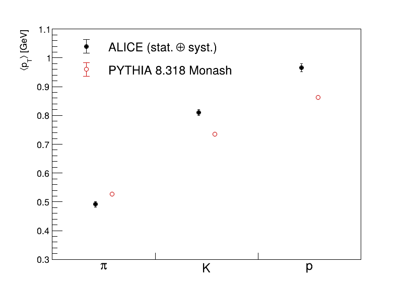

<!-- _class: title -->
<!-- _paginate: false -->

# Porównanie symulacji z danymi ALICE

PYTHIA 8.318 Monash 2013 · pp @ √s = 13.6 TeV i 13 TeV

Kacper Piotrowski

---

## Method

- ALICE publikuje wyniki już skorygowane na efekty detektora, więc możemy je porównać bezpośrednio z cząstkami z Pythii.
- Cząstki liczymy tak samo jak ALICE: te, które przed rozpadem przelatują ponad 1 cm, zostawiamy nierozpadnięte.
- ALICE używa dwóch klas zderzeń: INEL to wszystkie zderzenia niesprężyste, a INEL>0 to te, w których jest co najmniej jedna naładowana cząstka w |η| < 1.
- Symulacja ma po 100 000 zderzeń przy 13.6 TeV i 13 TeV, z tymi samymi ustawieniami.
- Dla 13.6 TeV ALICE podaje na razie tylko średnią gęstość cząstek (arXiv:2602.10658). Dla 13 TeV mamy też widma pionów, kaonów i protonów (HEPData ins1797443) oraz gęstość z arXiv:1509.08734.
- Widma z symulacji liczymy w tych samych przedziałach pT i w tej samej normalizacji co ALICE.

---

## Charged-particle density ⟨dNch/dη⟩

| √s | MC | ALICE | MC/ALICE |
|---|---|---|---|
| 13.6 TeV | 7.02 ± 0.02 | 7.10 ± 0.18 | 0.99 |
| 13 TeV | 6.96 ± 0.02 | 6.46 ± 0.19 | 1.08 |

Przy 13.6 TeV symulacja zgadza się z pomiarem w granicach niepewności, a ALICE dla tego samego tune'u w starszej wersji Pythii (8.311) podaje 7.11. Przy 13 TeV model daje o 8% za dużo, co zgadza się z oceną ALICE z 2016 r. (ok. 7%).

---

## Pion spectrum at 13 TeV

- Punkty to dane ALICE, szare pasma to ich niepewność. Dolny panel pokazuje MC/Data, gdzie 1 oznacza zgodność.
- Symulacja daje o 30–40% za dużo pionów w zakresie 0.3–5 GeV, a łącznie o 23% za dużo.
- Część różnicy wynika z tego, że przy 13 TeV model ogólnie zawyża liczbę cząstek na zderzenie (o 13%).
- Powyżej ok. 5 GeV symulacja ma za mało cząstek, żeby coś wnioskować.

---

## Kaon spectrum at 13 TeV

- Powyżej ok. 0.8 GeV symulacja zgadza się z danymi w granicach ok. 10%.
- Za dużo kaonów jest tylko przy niskim pT (do 45% przy 0.3 GeV).
- Łącznie kaonów jest o 17% za dużo.

---

## Proton spectrum at 13 TeV

- Podobnie jak dla kaonów: powyżej ok. 0.8 GeV jest zgodność, a przy niskim pT za dużo protonów (do 80%).
- Łącznie protonów jest o 20% za dużo.
- Powyżej 10 GeV w symulacji prawie nie ma protonów, więc te przedziały pomijamy na dolnym panelu.

---

## K/π ratio at 13 TeV

- Stosunek nie zależy od liczby zderzeń, więc lepiej sprawdza sam model.
- Przy pT od ok. 0.6 do 3 GeV symulacja daje o 20–25% za mało kaonów w stosunku do pionów.
- Przy pT poniżej 0.4 GeV jest odwrotnie: kaonów jest trochę za dużo.

---

## p/π ratio at 13 TeV

- W danych udział protonów rośnie z pT i osiąga maksimum ok. 0.28 przy 3 GeV.
- Symulacja ma maksimum w tym samym miejscu, ale przy pT od ok. 0.7 do 3 GeV daje o ok. 20% za mało protonów w stosunku do pionów.
- Model nie odtwarza więc w pełni tego, jak w danych protony przesuwają się do wyższych pT.

---

## Mean transverse momentum at 13 TeV

| | MC [GeV] | ALICE [GeV] | MC/ALICE |
|---|---|---|---|
| π | 0.527 | 0.491 ± 0.010 | 1.07 |
| K | 0.734 | 0.810 ± 0.010 | 0.91 |
| p | 0.862 | 0.966 ± 0.014 | 0.89 |

W danych średni pT rośnie z masą cząstki szybciej niż w symulacji. Model daje pionom za duży średni pT, a kaonom i protonom za mały.

---

## Summary and limitations

- Przy 13.6 TeV średnia gęstość cząstek naładowanych z symulacji zgadza się z ALICE (7.02 wobec 7.10 ± 0.18).
- Przy 13 TeV ten sam model daje za dużo cząstek (o 8% w INEL>0 i o 13% w INEL), co ALICE zauważyło już wcześniej.
- Model daje za dużo pionów w stosunku do kaonów i protonów (o ok. 20% przy 1–3 GeV), a średni pT za słabo rośnie z masą cząstki.
- Ograniczenia porównania:
  - jedno ustawienie modelu (Monash 2013),
  - przy 100 000 zderzeń symulacja ma mało cząstek powyżej ok. 5 GeV,
  - widma porównujemy tylko przy 13 TeV, bo dla 13.6 TeV ALICE jeszcze ich nie opublikowało,
  - niepewności ALICE są powiązane między przedziałami pT, więc dolny panel to ocena jakościowa.

ALICE: arXiv:2602.10658 (13.6 TeV); Phys. Lett. B 753 (2016) 319, arXiv:1509.08734; Eur. Phys. J. C 81 (2021) 256, arXiv:2005.11120, HEPData ins1797443 (doi:10.17182/hepdata.100303.v1)

